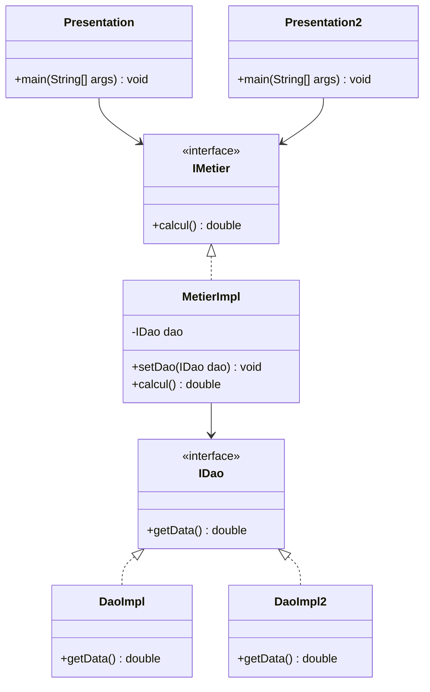
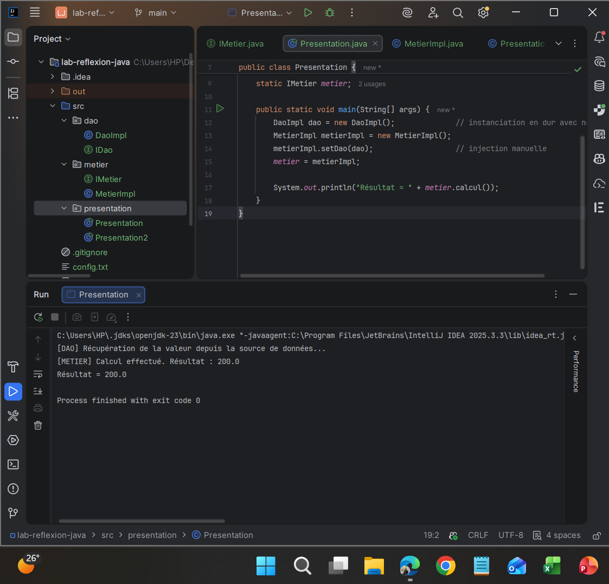
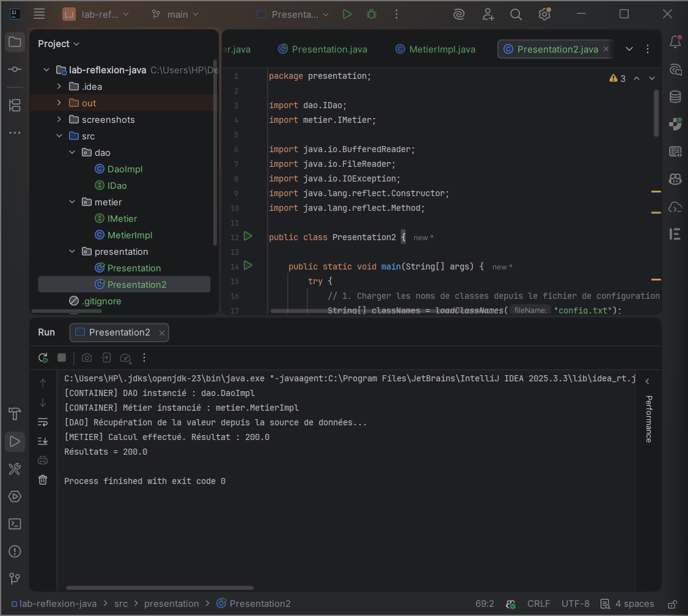
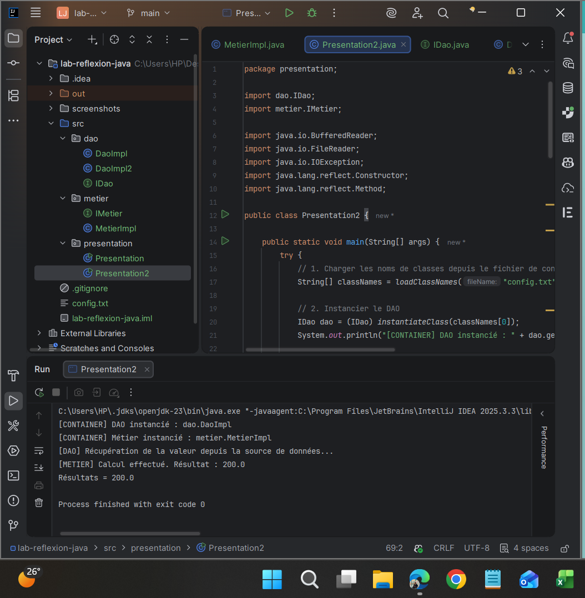

# Lab — Programmation dynamique en Java (API de réflexion)

**Réalisé par :** Hibatalah Hamrani
**Filière :** Cycle ingénieur DSI — EMSI Marrakech
**Module :** Frameworks et architecture microservices

---

## 🎯 Objectif

Comprendre comment fonctionnent les conteneurs d'injection de dépendances (comme Spring) en construisant un mini-conteneur avec les seules APIs natives de Java :

- charger une classe à partir de son nom (`Class.forName`)
- l'instancier dynamiquement (`Constructor.newInstance`)
- injecter une dépendance via un setter (`Method.invoke`)
- externaliser le choix des implémentations dans un fichier de configuration

---

## 🧩 Diagramme de classes



Chaque couche ne dépend que d'une **interface**, jamais d'une classe concrète : c'est le **couplage faible**.

---

## 📁 Structure du projet

```
lab-reflexion-java/
├── src/
│   ├── dao/
│   │   ├── IDao.java          # Interface de persistance
│   │   ├── DaoImpl.java       # Implémentation 1 (retourne 100.0)
│   │   └── DaoImpl2.java      # Implémentation 2 (retourne 50.0)
│   ├── metier/
│   │   ├── IMetier.java       # Interface métier
│   │   └── MetierImpl.java    # Calcul = getData() * 2
│   └── presentation/
│       ├── Presentation.java  # Version statique (new)
│       └── Presentation2.java # Version dynamique (réflexion)
├── screenshots/
└── config.txt                 # Noms des classes à charger
```

---

## ⚙️ Fonctionnement

### Version statique — `Presentation`

Les objets sont créés avec `new`, directement dans le code :

```java
DaoImpl dao = new DaoImpl();
MetierImpl metier = new MetierImpl();
metier.setDao(dao);
```

➡️ Pour changer d'implémentation, il faut **modifier le code et recompiler**.

### Version dynamique — `Presentation2`

Les noms des classes sont lus depuis `config.txt` :

```
dao.DaoImpl
metier.MetierImpl
```

Puis le programme utilise la réflexion :

```java
Class<?> clazz = Class.forName(className);                 // 1. Charger la classe
Object obj = clazz.getDeclaredConstructor().newInstance(); // 2. Créer l'objet
Method setter = metier.getClass().getMethod("setDao", IDao.class);
setter.invoke(metier, dao);                                // 3. Injecter le DAO
```

➡️ Pour changer d'implémentation, il suffit de **modifier une ligne de `config.txt`**.

---

## ▶️ Résultats

### 1. `Presentation` (statique)



### 2. `Presentation2` avec `dao.DaoImpl` → 200.0



### 3. `Presentation2` avec `dao.DaoImpl2` → 100.0



Entre les captures 2 et 3, **seul `config.txt` a changé**. Aucune ligne de Java n'a été modifiée, et le résultat passe de 200.0 à 100.0.

---

## 🚀 Exécution

Depuis IntelliJ : lancer `Presentation` ou `Presentation2` (le fichier `config.txt` doit être à la racine du projet).

En ligne de commande :

```bash
javac -d out src/dao/*.java src/metier/*.java src/presentation/*.java
java -cp out presentation.Presentation2
```

---

## 💡 Conclusion

`Presentation2` est un mini-conteneur d'injection de dépendances. Il applique trois principes que Spring automatise :

- **Couplage faible** : les couches communiquent via des interfaces.
- **Injection de dépendances** : `MetierImpl` ne crée pas son DAO, il le reçoit de l'extérieur.
- **Inversion de contrôle** : c'est le conteneur, à partir d'une configuration, qui décide quels objets créer.

Dans Spring, `@Component` joue le rôle de `config.txt`, et `@Autowired` celui de l'appel à `setDao` par réflexion.

> ⚠️ La réflexion a un coût en performance : elle est utilisée au démarrage de l'application, pas à chaque requête.